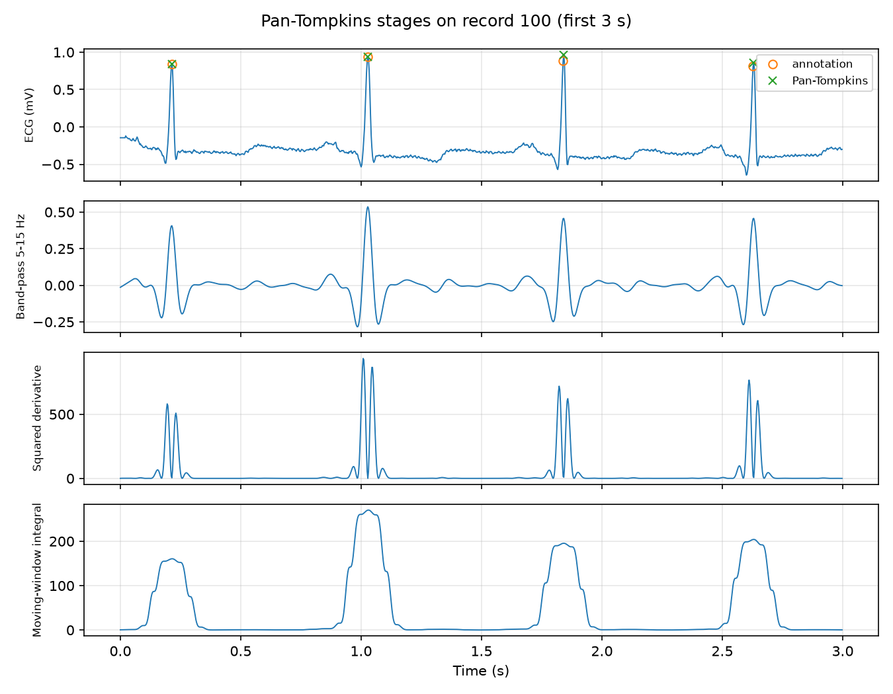
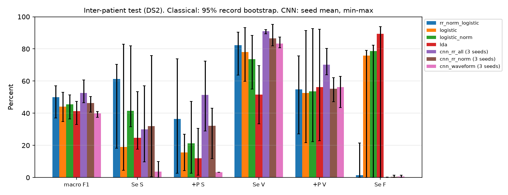

# NeuralECG

> I measured the reference results using the original benchmark environment.

**Classical and learned ECG processing on the MIT-BIH Arrhythmia Database:
QRS detection and inter-patient heartbeat classification**

I started with a classical baseline that I checked block by block, then built a
classical benchmark and compared a small neural network on the same data.

1. **QRS detection:** a Pan-Tompkins detector (band-pass, derivative, squaring,
   moving-window integration, adaptive thresholds, T-wave rule, searchback) against
   a simple fixed-threshold detector, on all 48 records and under added noise.
2. **Classical beat classification:** logistic regression and LDA on RR intervals
   and beat-shape samples, sorting beats into the four AAMI classes. I trained
   on one set of patients and tested on different patients (the inter-patient
   split), and also ran the usual random split to show how much it inflates scores.
3. **Learned beat classification:** a small 1-D CNN (about 15.5k parameters) with
   three choices of RR input, three seeds each, compared with the classical models
   on the same test beats, with record-bootstrap confidence intervals and noise tests.

```text
ECG (360 Hz, MLII) -> band-pass 5-15 Hz -> derivative -> square -> 150 ms integral
                   -> adaptive thresholds + T-wave rule + searchback -> R peaks
                   -> match to annotations (150 ms) -> Se, +P

ECG -> band-pass 0.5-40 Hz -> beat window (-0.25 s, +0.40 s) ----+-> logistic / LDA
annotated beats -> RR intervals -> raw and patient-normalized RR -+-> 1-D CNN
                                                                   -> N / S / V / F
```

AAMI classes: **N** normal and bundle branch block beats, **S** supraventricular
ectopic beats (early beats from the atria), **V** ventricular ectopic beats,
**F** fusion of normal and ventricular beats.

## Setup

I use Python 3.12 and [uv](https://docs.astral.sh/uv/). `uv.lock` pins every package.
Run everything from the project folder:

```powershell
uv sync --locked --extra neural
uv run pytest -q --basetemp=.pytest-tmp
uv run ruff check .
uv run ruff format --check .
```

PyTorch is only needed for stage 3. The lock file points at the CUDA 12.8 build of
torch 2.9.1; it also runs on a CPU. I trained on an RTX 3050 Laptop GPU (4 GB).

The data is the [MIT-BIH Arrhythmia Database](https://physionet.org/content/mitdb/1.0.0/)
v1.0.0 from PhysioNet (ODC-By licence). I put the `.dat`, `.hea` and `.atr` files
in `data/mitdb/` and checked all 144 of them against the published SHA-256 sums.
`data/` is not committed.

## Stage 1: QRS detection

```powershell
uv run python scripts/run_qrs_benchmark.py
```

I used lead MLII where it exists (all records except 102 and 104) and counted a
detection as correct if it was within 150 ms of an annotated beat, as in the
ANSI/AAMI EC57 standard. Se (sensitivity) is the share of real beats found; +P
(positive predictivity) is the share of detections that are real beats. I summed
TP, FP and FN over all records before dividing (gross statistics).

Results on all 48 records, 109,494 annotated beats:

| Signal | Pan-Tompkins Se | Pan-Tompkins +P | Fixed threshold Se | Fixed threshold +P |
|---|---:|---:|---:|---:|
| clean | 99.692% | 99.330% | 88.998% | 99.911% |
| white noise 18 dB | 99.686% | 99.414% | 88.963% | 99.909% |
| white noise 12 dB | 99.661% | 99.351% | 88.941% | 99.907% |
| white noise 6 dB | 99.617% | 99.263% | 88.703% | 99.907% |
| white noise 0 dB | 99.319% | 95.904% | 87.491% | 99.763% |
| 1 mV, 0.33 Hz baseline wander | 99.692% | 99.330% | 88.998% | 99.911% |

On clean signals Pan-Tompkins made 736 false detections and missed 337 beats,
close to the 99.75% / 99.54% usually quoted for the original algorithm. Most of
the false detections come from two records: 207 (374 FP, it has a ventricular
flutter episode whose waves are not annotated as beats) and 108 (269 FP, large P
waves and noise). The fixed threshold almost never fires on noise, but it misses
11% of beats, mostly in records where the QRS energy changes during the recording
(for example 215, 228 and 104). That is exactly what the adaptive thresholds fix.

White noise barely matters until 0 dB. I define SNR over the whole 0-180 Hz band,
but the 5-15 Hz band-pass keeps only about 1/18 of that noise, so the detector
works at a much better SNR than the label says. The 0.33 Hz wander is removed
completely by the same filter. Real muscle noise and electrode motion overlap
the QRS band, so this test is easier than real noise (see limitations).



## Stage 2: classical beat classification

```powershell
uv run python scripts/run_classical_classification.py
```

I used the inter-patient split by de Chazal et al. (2004): records in DS1 for
training, records in DS2 for testing, no patient in both. The four paced records
(102, 104, 107, 217) are excluded. I held out four DS1 records (114, 118, 124, 223)
as a validation set for the CNN, and I trained the classical models on the same
remaining 18 records so that every model sees the same data. My beat counts add up
to the published DS1 and DS2 counts within a few beats:

| Set | N | S | V | F |
|---|---:|---:|---:|---:|
| training (18 DS1 records) | 38,265 | 731 | 3,209 | 391 |
| validation (4 DS1 records) | 7,559 | 212 | 579 | 23 |
| test (22 DS2 records) | 44,218 | 1,836 | 3,219 | 388 |

N is 89% of the test beats, so accuracy says very little. I report Se and +P for
each class and macro F1 (the mean F1 over the four classes). The brackets are 95%
intervals from resampling the 22 test patients with replacement (record bootstrap).

| Model (DS2 test) | Macro F1 | Se S | +P S | Se V | +P V | Se F |
|---|---:|---:|---:|---:|---:|---:|
| RR only, raw + ratios | 39.5 | 6.6 | 11.6 | 85.9 | 36.3 | 82.5 |
| RR only, patient-normalized | **49.9** [37.1, 57.1] | **61.4** [18.2, 70.4] | 36.4 | 82.3 | 54.8 | 1.5 |
| LDA, shape + RR | 41.3 | 24.7 | 12.0 | 51.7 | 56.2 | 89.4 |
| LDA, shape + normalized RR | 36.8 | 9.2 | 3.3 | 45.3 | 53.1 | 84.0 |
| Logistic, shape + RR | 44.0 | 19.1 | 15.6 | 78.0 | 52.6 | 75.8 |
| Logistic, shape + normalized RR | 45.6 | 41.6 | 21.3 | 73.5 | 53.6 | 78.6 |
| Logistic, shape + normalized RR, **random split** | 60.8 | 89.7 | 37.9 | 89.2 | 67.0 | 83.1 |

What I found:

- **Raw RR intervals do not transfer between patients.** The S beats in my
  training records come from patients with fast rhythms (median RR before the
  beat 0.47 s). Most test S beats come from record 232, which has a slow rhythm
  (median 0.72 s over all test S beats). With raw RR in seconds, the model labels
  those beats as V. When I divide each RR interval by that patient's own average
  over the last 5 minutes, S sensitivity goes from 6.6% to 61.4% with the same
  classifier.
- **Beat shape features did not help S beats across patients.** Beat shape depends
  a lot on the patient and electrode placement. Starting from normalized RR,
  adding 39 shape samples lowered S sensitivity from 61.4% to 41.6% (logistic) and
  9.2% (LDA).
- **The random split is badly optimistic.** With beats from the same patients in
  both training and test, the same model reaches 89.7% S sensitivity instead of
  41.6%. Many published results use this split, so their numbers are not
  comparable with inter-patient results.
- The intervals are very wide (S sensitivity 18% to 70%) because record 232 holds
  75% of the test S beats. Twenty-two test patients is not many.

## Stage 3: learned beat classification

```powershell
uv run --extra neural python scripts/train_beat_classifier.py
uv run --extra neural python scripts/evaluate_beat_classifier.py
```

The CNN has three convolution blocks (16, 32 and 64 channels), global average
pooling, and then a small dense head. The RR features can be concatenated before
the head. I tried three inputs: no RR (`cnn_waveform`), the 3 patient-normalized
ratios (`cnn_rr_norm`) and all 7 RR features (`cnn_rr_all`). Training uses
class-weighted cross entropy, AdamW, amplitude and noise augmentation and 20
epochs. I kept the epoch with the best validation macro F1. The validation set
only contains DS1 records, so the test set never chose anything. Each variant ran
with seeds 11, 22 and 33, and runs with the same seed are bit-for-bit identical.

DS2 test, mean over 3 seeds with [min, max]:

| Model | Macro F1 | Se S | +P S | Se V | +P V | Accuracy |
|---|---:|---:|---:|---:|---:|---:|
| cnn_rr_all | 52.6 [46.5, 60.7] | 29.9 [9.8, 57.0] | 51.3 | **91.0** [89.4, 92.1] | **70.2** | 90.0 |
| cnn_rr_norm | 46.3 [40.6, 50.5] | 32.0 [0.4, 75.8] | 32.3 | 86.6 [82.0, 95.2] | 55.1 | 84.4 |
| cnn_waveform | 39.9 [37.5, 41.2] | 3.7 [0.0, 10.0] | 3.2 | 83.2 [80.7, 87.3] | 56.2 | 83.5 |
| best classical (RR only, normalized) | 49.9 | 61.4 | 36.4 | 82.3 | 54.8 | 78.4 |

What I found:

- **The CNN is clearly better at V beats.** With all RR features it found 91.0% of
  V beats (all three seeds between 89.4% and 92.1%) with 70.2% +P, against 82.3%
  and 54.8% for the best classical model.
- **It is not reliably better overall.** Macro F1 depends a lot on the seed
  (46.5 to 60.7 for the same model). In a paired record bootstrap (both models
  scored on the same resampled patients), only one of the nine CNN runs was
  significantly better than the RR-only classical model: cnn_rr_all seed 22,
  +10.8 macro-F1 points [3.1, 19.9]. The other eight intervals include zero.
- **S beats are the weak point.** The same CNN can find most S beats (75.8% for
  cnn_rr_norm seed 11) or almost none (0.4% for seed 33). The validation records
  hold only 212 S beats from four patients, so the validation score cannot tell a
  good run from a bad one.
- **Shape alone is not enough.** Without RR features the CNN almost never
  predicts S. An S beat often looks like a normal beat; what gives it away is
  that it comes early.
- **No model learned F beats across patients.** 95% of the training F beats come
  from record 208 and 93% of the test F beats from record 213. The classical
  shape models flag many F beats (Se F 76-89%), but only by sending many N beats
  to F (low +P), and the CNNs find almost none.
- **Noise:** with white noise down to 12 dB, mean macro F1 for cnn_rr_all stayed
  at 52.2 (V sensitivity fell from 91.0% to 84.6%). The classical shape models
  lost at most 2.8 points. Here RR intervals come from the annotations, so noise
  only reaches the beat shape.
- **Size and speed:** about 15.5k parameters and 0.46-0.58 ms per beat on one CPU
  thread (batch of 1), so a beat-by-beat version is small enough for a
  microcontroller.



## Project layout

```text
neural-ecg/
|-- pyproject.toml, uv.lock, README.md
|-- configs/
|   |-- qrs_detection/protocol.json          noise conditions and seeds
|   `-- beat_classification/protocol.json    split, features, CNN runs, seeds
|-- src/neural_ecg/
|   |-- config.py, records.py                record lists, AAMI map, loading
|   |-- filters.py, qrs.py                   band-pass, derivative, Pan-Tompkins
|   |-- detection_metrics.py, noise.py       beat matching, noise, seeded RNG
|   |-- beats.py, conditions.py              beat windows, RR features, caching
|   |-- classical.py, neural.py              logistic/LDA and the CNN
|   |-- classification_metrics.py            confusion, Se/+P/F1, record bootstrap
|   `-- protocol.py, reporting.py, plotting.py, artifacts.py
|-- scripts/                                 the four stage scripts
|-- tests/                                   pytest suite (synthetic ECG + data checks)
`-- results/                                 CSV, JSON and PNG results
```

## Limitations

- My Pan-Tompkins is offline: the filters are zero-phase (`filtfilt`), so it sees a
  little of the future. A real-time version needs causal filters and a delay
  correction.
- The added noise is white Gaussian or a pure sinusoid. The MIT-BIH Noise Stress
  Test Database (real muscle and motion noise) would be a harder and more
  realistic test. I have not used it yet.
- The classifiers use the annotated R peaks and RR intervals, not my detector's
  output, and they use one beat of lookahead (the RR interval after the beat).
- 22 test patients give wide confidence intervals; one record holds most S beats
  and another most F beats.
- Choosing the epoch on four validation records is not reliable for S beats. Next
  I would try cross-validation across DS1 patients and averaging seeds.
